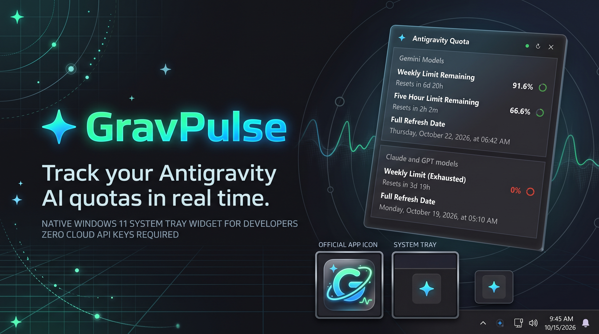
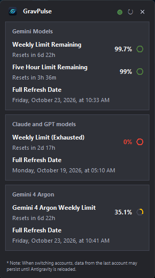
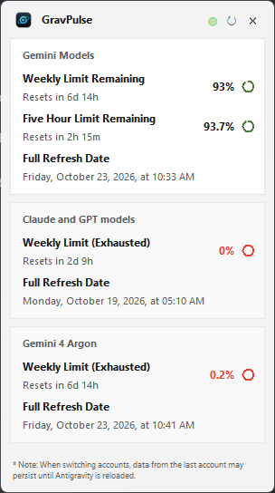
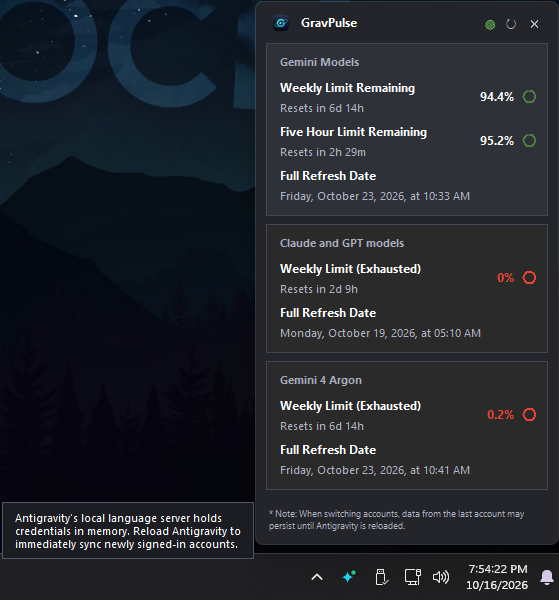
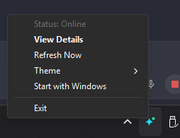
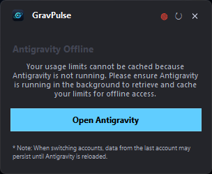
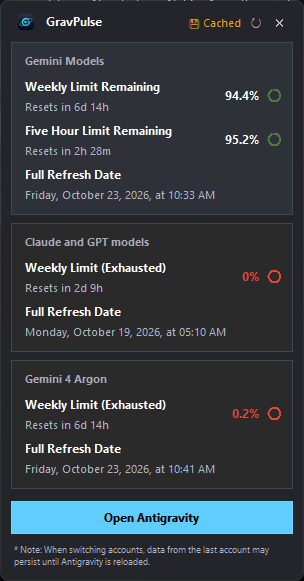
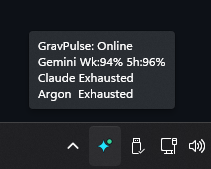
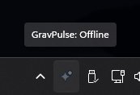

# GravPulse



> **Track your Antigravity AI quotas in real time.**

GravPulse is a zero-config Windows 11 system tray widget that hooks directly into your local Antigravity language server RPC to monitor AI model quotas. Track 5-hour and weekly quotas for Gemini, Claude, and GPT models with live reset countdowns and native desktop alerts—no cloud API keys required.

---

## Highlights

- **Zero-Config Auto-Discovery:** Seamlessly connects to your locally running Antigravity Language Server RPC (`language_server.exe`) via internal ConnectRPC protocol. Zero cloud API tokens or authentication keys needed.
- **Windows 11 Fluent Design:** Borderless, 100% solid dark-mode popover card with hardware-level GDI rounded corners (16px), native DWM drop shadow, Segoe UI typography, and subtle interactive hover states.
- **Smart Best-Available Status:** System tray icon reflects your active coding capacity. If Gemini is full (92%) and Claude is exhausted (0%), your tray icon stays **Green (Active)** so you know you can keep coding without interruption.
- **Cached Offline Mode with Clock Math:** If Antigravity closes, GravPulse retains your last known quota and continuously recalculates reset countdowns live against your system clock—with an amber indicator dot and a 1-click **Open Antigravity** launcher.
- **Proactive Notifications:** Automatic Windows toast alerts when a model limit drops below 10% or fully resets.
- **System Theme Adaptation:** Automatically syncs with Windows Dark Mode or Light Mode preferences, with manual overrides via right-click context menu.

---

## Screenshots & Preview

<div align="center">

### Popover Window (Dark & Light Mode)

| Dark Mode Popover | Light Mode Popover |
| :---: | :---: |
|  |  |

### Interactive Tooltips & Native Context Menu

| Quota Tooltips & Exhausted Card | Win32 Tray Context Menu |
| :---: | :---: |
|  |  |

### Offline Cache & Tray Hover Previews

| Offline Mode with 1-Click Launcher | Cached Quota Tray Tooltip |
| :---: | :---: |
|  |  |

| Online Tray Hover Status | Offline Tray Hover Status |
| :---: | :---: |
|  |  |

</div>

---

## Quickstart

### Option A: Standalone Executable (Recommended)
Download `GravPulse.exe` directly from the [Releases](https://github.com/Unknownplanet40/gravpulse/releases) page—no Python or dependencies required:
1. Download `GravPulse.exe`.
2. Run `GravPulse.exe`. The widget starts quietly in your Windows system tray.

### Option B: Run from Source

#### Prerequisites
- Windows 10 / 11
- Python 3.10+ (with `tkinter`)
- Google Antigravity IDE

#### 1. Installation
Clone the repository and install dependencies:
```powershell
git clone https://github.com/Unknownplanet40/gravpulse.git
cd gravpulse
pip install -r requirements.txt
```

#### 2. Launch
Start GravPulse in the background:
- Double-click `run.vbs` (or `run.bat`), or run via PowerShell:
  ```powershell
  pythonw main.pyw
  ```

### Build Standalone Executable
Compile `GravPulse.exe` locally with embedded version resources:
```powershell
.\build.bat
```
The compiled single-file binary will be saved in `dist/GravPulse.exe`.

---

## Usage

| Interaction | Action |
| :--- | :--- |
| **Left-Click Tray Icon** | Toggles the fluent popover card showing circular progress rings, remaining percentages, and exact reset dates/times. |
| **Right-Click Tray Icon** | Displays quick connectivity status (`● Status: Online`), manual **↻ Refresh Now**, **🔔 Test Notification**, **🎨 Theme** picker, **🚀 Start with Windows** toggle, and **✕ Exit**. |
| **Hover Limit Rows** | Displays flyout tooltips explaining quota rules and exact reset datetimes in your local timezone. |
| **Offline State** | Shows an amber status dot with a 1-click Windows 11 Fluent **Open Antigravity** launch button. |

---

## Tray Status Indicator

GravPulse uses an intelligent best-available capacity algorithm so you always know your true coding status:

| Icon Status | Condition | Meaning |
| :---: | :--- | :--- |
|  <br/> **Active** | Best model capacity > 50% | High capacity available. Ready for heavy pair programming. |
|  <br/> **Warning** | Best model capacity 1% – 50% | Capacity is half-depleted or nearing reset window. Pace your requests. |
|  <br/> **Exhausted** | 0% across ALL model groups | All rate limits exhausted. Waiting on countdown reset. |
|  <br/> **Offline** | Disconnected / No Cache | Antigravity is closed and no prior quota snapshot exists. |

---

## Repository Structure

```
├── assets/                 # GravPulse official visual brand assets
│   ├── banner.jpg          # Project banner preview
│   ├── samples/            # UI screenshots & preview captures
│   │   ├── popup.png       # Dark mode popover
│   │   ├── lightmode.png   # Light mode popover
│   │   ├── popup-items-hover.png # Quota tooltip & exhausted styling
│   │   ├── tray-context-menu.png # Win32 tray menu
│   │   ├── online-tray-hover.png # Live tray tooltip
│   │   ├── offline-popup.png     # 1-click launcher
│   │   └── offline-cached.png    # Offline clock math
│   ├── ico/app.ico         # Application icon
│   ├── png/                # High-res logos and app marks (16px to 1024px)
│   ├── svg/                # Scalable vector sources
│   └── tray/               # Multi-resolution tray status PNGs
├── src/
│   ├── collector.py        # Antigravity ConnectRPC auto-discovery & cached offline engine
│   ├── popup.py            # Windows 11 Fluent popover card with semi-trans exhausted cards
│   ├── tray.py             # Pystray tray daemon with smart capacity & Win32 context menu
│   ├── notification.py     # Native Windows toast notification dispatcher with icon cache
│   ├── theme.py            # Windows dark/light theme detection & semi-trans color palettes
│   ├── startup.py          # Windows shell:startup shortcut manager
│   └── paths.py            # PyInstaller _MEIPASS resource resolver
├── tests/
│   ├── test_collector.py   # Unit test suite for collector, tray, and themes
│   ├── test_paths.py       # Unit test suite for frozen path resolution
│   └── test_skills.py      # Unit test suite for workspace skills
├── build.bat               # 1-click local PyInstaller packaging script
├── GravPulse.spec          # PyInstaller packaging configuration
├── version_info.txt        # Windows PE file and product version metadata
├── docs/                   # Product specifications (PRD) and architecture guides
├── main.pyw                # Single-instance application entry point
├── run.vbs                 # Windowless background launcher (zero console flash)
├── run.bat                 # 1-click batch launcher
├── requirements.txt        # Minimal runtime dependencies (psutil, pystray, Pillow)
├── PROJECT-LOG.md          # Permanent append-only session history & decision log
└── handoff.md              # Active state and next steps snapshot
```

---

## Running Tests

GravPulse includes an automated test suite verifying process discovery, countdown calculation, tray icon generation, alert evaluation, and theme resolution:

```powershell
python -m unittest discover tests
```

---

## License

MIT License. Designed with care for developers using Google Antigravity.
