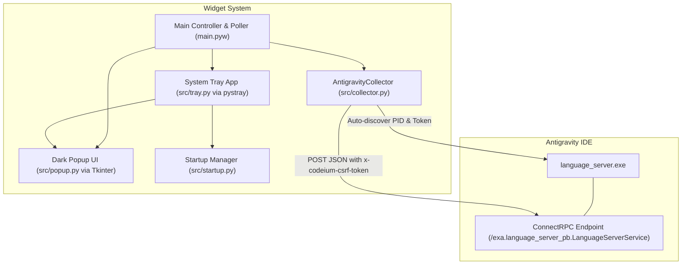

# System Architecture: Antigravity Quota Widget

## Overview

The Antigravity Quota Widget is a native Windows desktop utility running via Python. It connects to the locally running Antigravity IDE `language_server.exe` instance over ConnectRPC/HTTP, extracts real-time bucket quotas, and visualizes them through a Windows System Tray icon and dark-themed popup window.

---

## Component Boundaries

1. **`src/collector.py` (Data Layer)**
   - Queries Windows CIM (`Win32_Process`) to extract the Antigravity `language_server.exe` PID and `--csrf_token`.
   - Enumerates listening TCP ports for that PID via `Get-NetTCPConnection`.
   - Calls `/exa.language_server_pb.LanguageServerService/RetrieveUserQuotaSummary` with `Connect-Protocol-Version: 1`.
   - Caches connection details for instantaneous subsequent requests.
   - Parses model groups ("Gemini Models", "Claude and GPT models"), remaining fractions, and reset countdown strings.

2. **`src/tray.py` (Shell Integration Layer)**
   - Uses `pystray` and `PIL` to dynamically render a 64x64 icon with the Antigravity sparkle logo and a colored status indicator dot:
     - Green: Lowest quota >= 50%
     - Amber: Lowest quota 15% - 49%
     - Red: Lowest quota < 15%
     - Grey: Offline / 0%
   - Provides right-click context menu with snapshot lines, manual refresh, and startup toggle.

3. **`src/popup.py` (Presentation Layer)**
   - Borderless, dark-slate (`#181a20`) card positioned directly above the Windows taskbar.
   - Draws circular progress rings on anti-aliased Tkinter canvases.
   - Automatically hides when the window loses focus (`<FocusOut>`) or Escape is pressed.

4. **`src/startup.py` (System Persistence Layer)**
   - Creates and manages a Windows `.lnk` shortcut inside `%APPDATA%\Microsoft\Windows\Start Menu\Programs\Startup` pointing to `pythonw.exe main.pyw`.

5. **`main.pyw` (Application Coordinator)**
   - Owns the Tkinter root mainloop on the main thread.
   - Runs `pystray` in a background daemon thread.
   - Runs a 60-second polling worker that updates the icon, updates the open popup, and triggers native toast notifications.